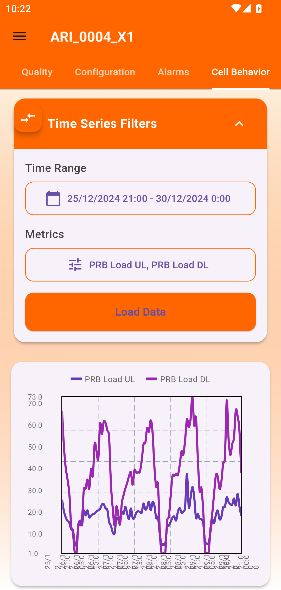
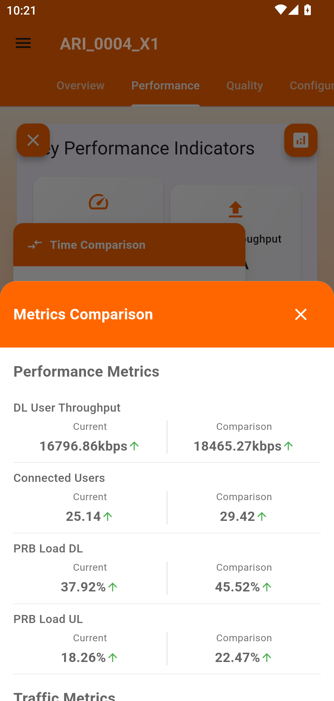
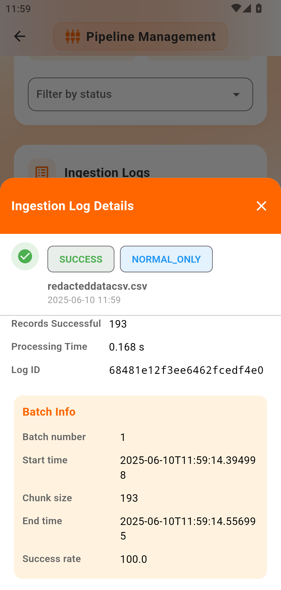
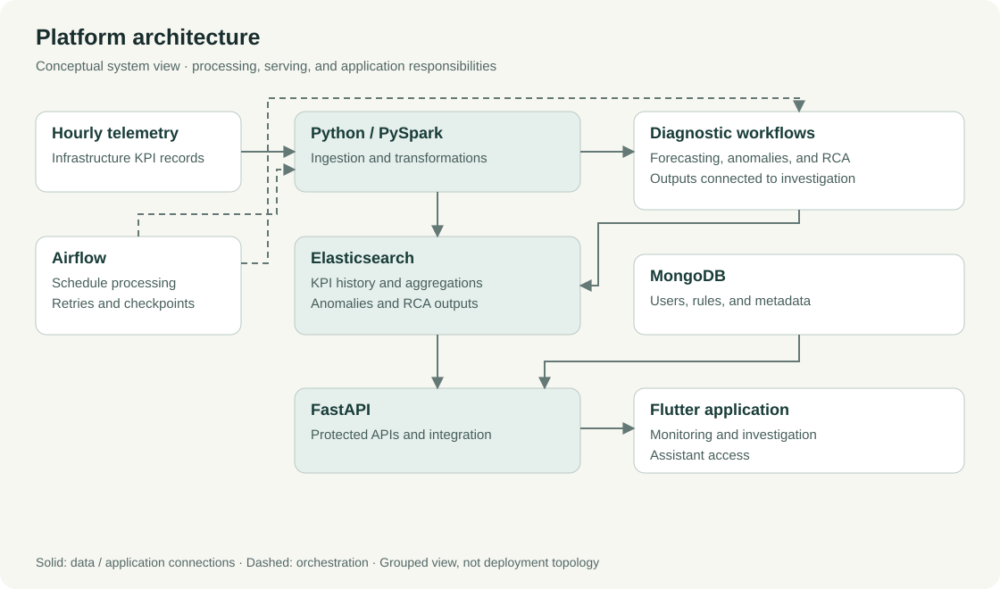
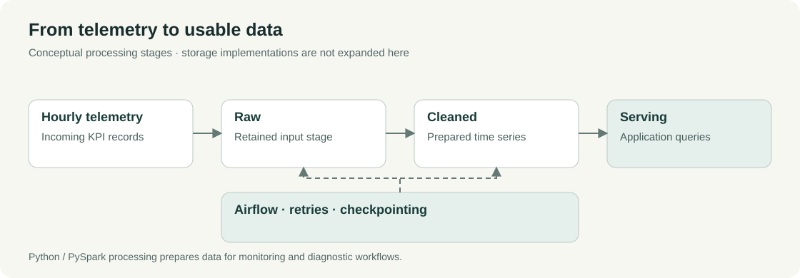
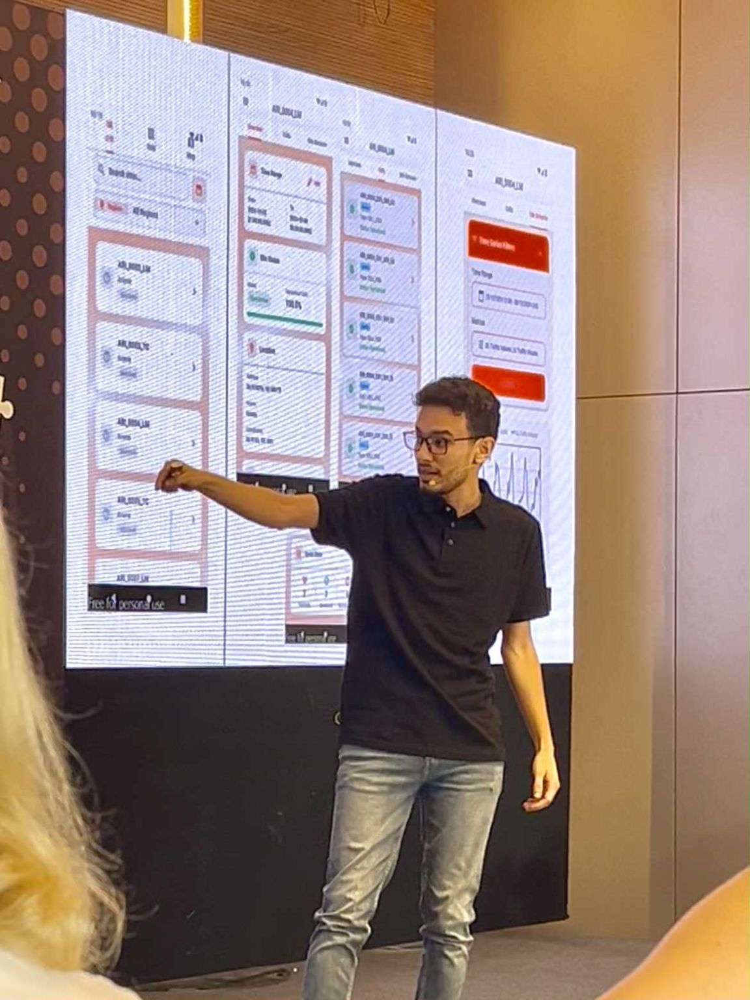

# Infrastructure Monitoring & Analytics Platform

**From infrastructure telemetry to operational investigation — Orange Tunisia.**

I designed and built an internal monitoring and diagnostics platform connecting data pipelines, backend services, and a Flutter application. It brought KPI history, alarms, anomaly detection, root-cause analysis, and an assistant into one product for operational engineers.

**Role:** end-to-end platform design and implementation · **Period:** January 2025–February 2026

[Portfolio case study](https://oussamajaouadi.vercel.app/projects/infrastructure-monitoring-and-analytics-platform) · [Agent deep dive](https://github.com/oussjd2/operational-analytics-agent-case-study) · [RCA and forecasting](https://github.com/oussjd2/rca-anomaly-forecasting-workflows)

> Documentation of a private internal product. Application code, internal datasets, credentials, and operational configurations are excluded. Screens below are existing portfolio images; diagrams describe the system at a conceptual level.

## The problem

Engineers investigated incidents through separate tools and manual checks. Reviewing a performance change meant finding the right site or cell, checking historical indicators, comparing periods, and gathering diagnostic context. The platform connected those tasks in one mobile-first workflow.

## Inside the product

<table>
<tr>
<td width="33%" valign="top"> <strong>Inspect KPI history</strong> Select metrics and a time window for a cell.</td>
<td width="33%" valign="top"> <strong>Compare periods</strong> Review throughput, connected users, and resource load together.</td>
<td width="33%" valign="top"> <strong>Trace ingestion</strong> Inspect batch status and processing details when checking a data issue.</td>
</tr>
</table>

Click a screen to view its full resolution. Original aspect ratios and interface content are preserved. These views demonstrate features, not a single incident or a performance benchmark.

## What I built

- **Data processing:** hourly telemetry ingestion, cleaning, and separate raw, cleaned, and serving datasets.
- **Backend:** protected FastAPI endpoints, user roles, site/cell management, dashboards, and alarm workflows.
- **Product:** the Flutter application and connections to forecasting, anomaly detection, RCA, and assistant-supported investigation.
- **Reliability:** scheduled workflows with retries, checkpointing, and ingestion visibility.

## System architecture

Solid arrows show main data and application connections. Dashed arrows show scheduling and orchestration. Diagnostic workflows are grouped for readability; this is not a deployment topology.

| Layer | Responsibility |
|---|---|
| Flutter | Monitoring, comparisons, alarms, and investigation interfaces |
| FastAPI | Protected APIs and access to operational and analytical services |
| MongoDB | Users, rules, and application metadata |
| Elasticsearch | KPI history, search, aggregations, anomalies, and diagnostic outputs |
| Python / PySpark | Ingestion, transformations, and analytical processing |
| Airflow | Scheduling and orchestration of processing workflows |
| Diagnostic workflows | Forecasting, anomaly detection, RCA, and assistant integration |

## From telemetry to usable data

Processing stages were separated so ingestion and analytics could evolve independently. Users could inspect ingestion logs in the application. The pictured batch is one processing record; its displayed success rate does not establish overall pipeline reliability.

## Engineering decisions

| Decision | Reason and implication |
|---|---|
| Separate MongoDB and Elasticsearch responsibilities | Application metadata and analytical query patterns have different needs. MongoDB held users and rules; Elasticsearch served KPI history, search, and aggregations. |
| Separate processing stages | Ingestion and diagnostic processing could be updated independently while retaining raw, cleaned, and serving boundaries. |
| Recover scheduled work with retries and checkpoints | Processing needed a recovery path after failure; scheduling alone was insufficient. |
| Connect diagnostics to operator workflows | Forecasting, anomaly detection, and RCA outputs were accessible through the product instead of remaining isolated analytical jobs. |

## Investigation workflow

This describes a supported product journey, not a reconstructed production incident:

1. Open a site or cell and choose a time window.
2. Inspect KPI history and compare it with another period.
3. Continue into anomaly review and RCA reports when a change needs investigation.
4. Review candidate causes and supporting evidence; use the assistant to access operational context.
5. Let the engineer decide the next diagnostic action.

The [agent case study](https://github.com/oussjd2/operational-analytics-agent-case-study) explains conversational access to that evidence. The [RCA case study](https://github.com/oussjd2/rca-anomaly-forecasting-workflows) covers the diagnostic subsystem.

## Outcomes and scope

| Measure | Documented result |
|---|---|
| Infrastructure coverage | 1,500+ endpoints and 60+ KPIs |
| Processing volume | Millions of records per day |
| Routine investigation time | About 5 minutes with manual checks → 1.5 minutes with the platform |
| Measurement period | Six months |
| Investigation-time reduction | Approximately 70%: `(5 − 1.5) / 5` |

The timing concerns routine investigation, **not total incident-resolution time or MTTR**. These project-reported results are carried over from the portfolio. Internal timing records and operational datasets are not published here; this is not an independently reproducible benchmark.

## From building to presenting

I presented the platform at Orange Tunisia's Challenge PFE on **20 June 2025**. It was selected among eight finalist projects from more than 120 submissions.

[Event post and presentation context](https://www.linkedin.com/posts/oussama-jaouadi-99335a1a8_challengepfe-orangetunisie-activity-7349909470577078274-zzb8)

## Stack and further reading

Flutter · FastAPI · Python · PySpark · Airflow · Elasticsearch · MongoDB · Docker

- [Full portfolio case study](https://oussamajaouadi.vercel.app/projects/infrastructure-monitoring-and-analytics-platform)
- [Operational Analytics Agent](https://github.com/oussjd2/operational-analytics-agent-case-study)
- [RCA, Anomaly and Forecasting Workflows](https://github.com/oussjd2/rca-anomaly-forecasting-workflows)
- [Visual sources and scope](docs/visual-sources.md)
- [Editable diagram sources](docs/diagrams.md)

**Oussama Jaouadi** · [Portfolio](https://oussamajaouadi.vercel.app) · [LinkedIn](https://www.linkedin.com/in/oussama-jaouadi-99335a1a8/)
