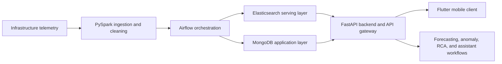

# Infrastructure Monitoring and Analytics Platform

Documentation for a mobile-first internal monitoring and diagnostics platform built for operational infrastructure teams.

> Proprietary code and internal data are not included. This repository documents the architecture, system design, ownership boundaries, and sanitized implementation details.

## Summary

The platform unified infrastructure telemetry, KPI dashboards, alarm workflows, forecasting, anomaly detection, root-cause analysis, and assistant-supported investigation in one operator-facing system.

The engineering scope covered backend services, data pipelines, analytics serving, monitoring workflows, and productized diagnostic tooling.

## Scale

- 1,500+ distributed infrastructure endpoints
- 60+ operational KPIs
- Millions of records processed per day
- 50+ internal users
- More than 96% measured pipeline success rate in one variant
- More than 70% reduction in manual troubleshooting effort
- More than 40% MTTR reduction

## Architecture

## Core Subsystems

- Mobile-first Flutter client for operational users
- FastAPI backend and API gateway
- MongoDB application layer
- Elasticsearch analytics and serving layer
- PySpark processing jobs
- Airflow orchestration, scheduling, checkpointing, and recovery
- KPI dashboards, site/cell views, alarms, and investigation flows
- Forecasting and anomaly detection outputs connected to operator workflows
- Root-cause analysis summaries and ranked probable causes

## Engineering Scope

- Ingestion pipeline design
- Spark and Airflow processing
- Elasticsearch indexing and query patterns
- Backend API design
- Dashboard and mobile workflow integration
- Forecasting and anomaly workflow integration
- RCA and assistant workflow integration
- Internal product delivery

## Tech Stack

Flutter, FastAPI, Python, PySpark, Airflow, Elasticsearch, MongoDB, time-series processing, anomaly detection, forecasting, RCA workflows.
