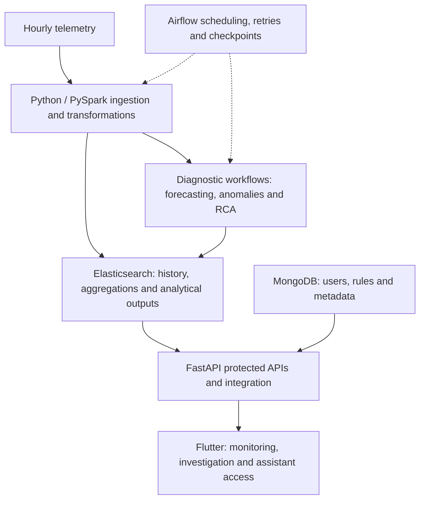
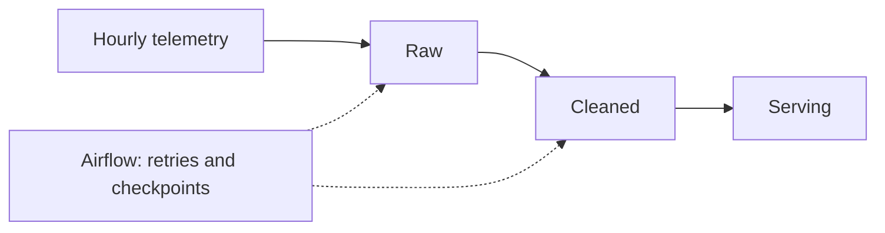

# Editable diagram sources

Conceptual diagrams of the publicly described system. The README uses SVG versions for predictable rendering. Keep these sources and the SVGs aligned.

## Platform architecture

Solid arrows show main connections; dashed arrows show orchestration. This groups subsystems rather than documenting deployment topology.

## Data stages

Python / PySpark processing prepares telemetry for application queries and diagnostic workflows. Storage implementations are omitted from this stage-level view.
